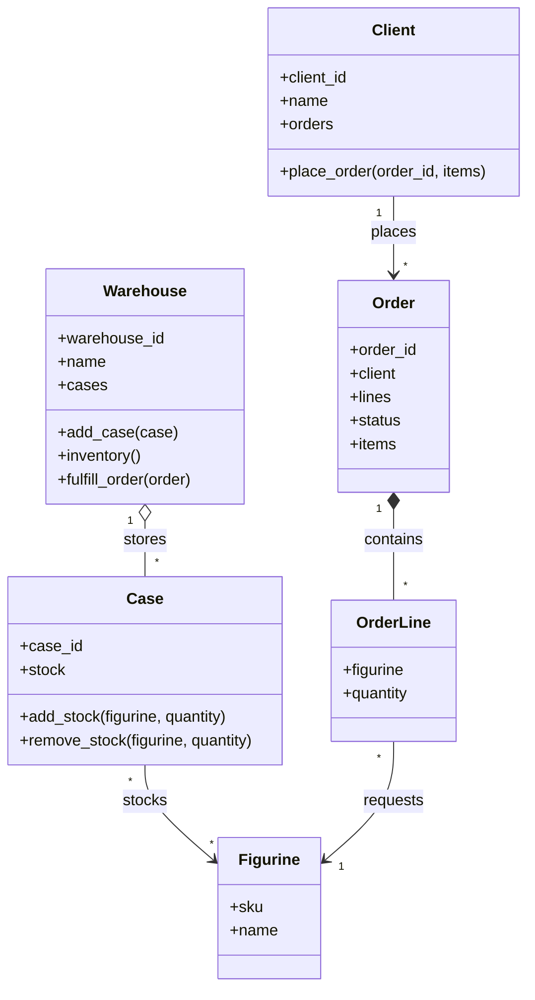

# Class Diagram

## Why these classes?
- `Figurine`: product identity.
- `Case`: physical storage and per-case quantities.
- `Warehouse`: inventory totals and order fulfillment.
- `Client`: customer details and order history.
- `Order`: requested products and shipment status.
- `OrderLine`: helper class for an item and quantity. If the instructor strictly requires only five classes, order lines can be stored as a dictionary inside `Order` instead.
